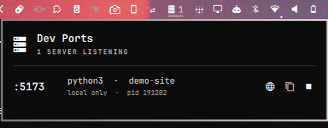

# Dev Ports

An [Omarchy](https://omarchy.org/) bar plugin that lists the local dev servers
listening on TCP ports, and lets you open, copy, or stop them from the bar.



## Features

- **Live count in the bar** — a server icon followed by the number of
  listening dev servers. Hidden when nothing is running (configurable).
- **One row per port** — port, process name, project folder (the process's
  working directory), whether it is local only or exposed on the network,
  and its PID.
- **Actions** — open `http://localhost:PORT` in the browser, copy the URL,
  copy the Tailscale URL (`http://<tailscale-ip>:PORT`, only for servers
  bound to all interfaces), or stop the server (`kill`, SIGTERM).
- **Noise filtering** — only your own processes are listed; ports above
  32767 (ephemeral IPC ports) and a list of known desktop apps are ignored.

## Install

```bash
omarchy plugin add https://github.com/devfrp/omarchy-dev-ports --enable
```

The widget is placed in the right section of the bar.

## Remove

```bash
omarchy plugin remove devfrp.dev-ports
```

## Dependencies

- `ss` (iproute2), `jq`, `wl-copy` (wl-clipboard) — all present on a
  standard Omarchy install.
- `tailscale` — optional, only for the "copy Tailscale URL" action.

## Controls

- **Left click** — open the panel.
- **Right click** — open the first server in the browser.
- **Middle click** — refresh now.

## Settings

Set these on the widget entry in `~/.config/omarchy/shell.json`:

| Key | Default | Meaning |
|-----|---------|---------|
| `refreshIntervalSec` | `5` | Polling interval in seconds |
| `maxPort` | `32767` | Ports above this are ignored |
| `hideWhenEmpty` | `true` | Hide the widget when no server is running |
| `ignore` | `Discord,kdeconnectd,wayvnc,steam,spotify,cupsd` | Comma-separated process names to ignore |

Example:

```json
{ "id": "devfrp.dev-ports", "hideWhenEmpty": false, "ignore": "Discord,codium" }
```

## Files and permissions

- Read-only: runs `ss -tlnp` and reads `/proc/<pid>/cwd` and
  `/proc/<pid>/cmdline` for your own processes.
- The stop action sends SIGTERM to the selected PID only; it never uses
  `sudo`, so servers owned by root (e.g. Docker's `docker-proxy`) are not
  listed and cannot be stopped.
- Writes no files and never touches packaged Omarchy files.

## Development

```bash
bin/dev-ports "Discord,wayvnc" 32767   # JSON list of listeners
omarchy plugin validate .
```

## License

[MIT](LICENSE)
